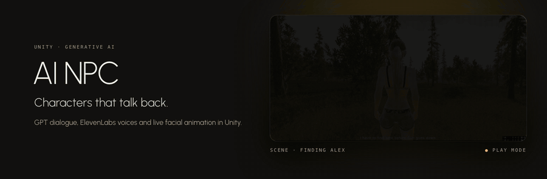
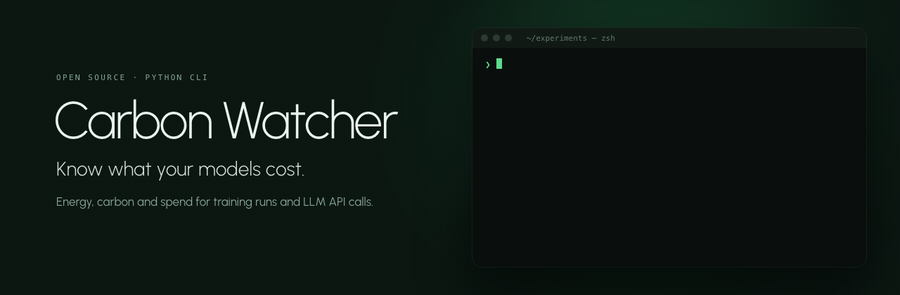
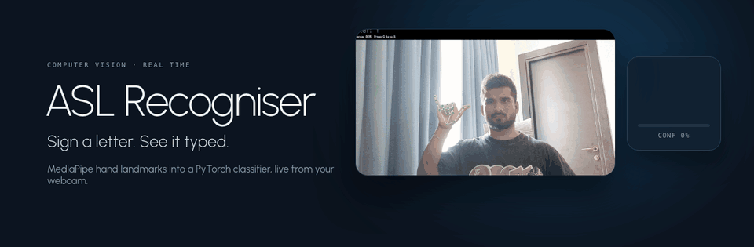
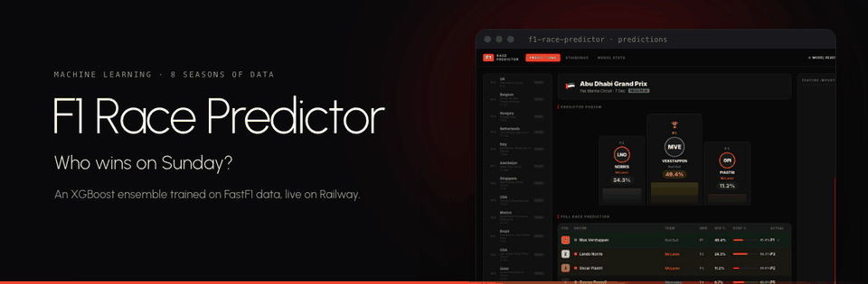

<div align="center">
  


**AI & Data Engineer · Data Scientist · NLP · Computer Vision · Generative AI**

*Pune, India · Open to roles · 2026*

[](https://www.linkedin.com/in/ghanshyampaunikar/)
[](https://ghanshyampaunikar.com)
[](mailto:ghanshyampaunikar@gmail.com)
[](https://medium.com/@ghanshyampaunikar)
[](https://buymeacoffee.com/ghanshyampaunikar)

</div>

---

## About

Pune-based AI & Data practitioner, previously Data Analyst at Sigma AI. I build production-ready systems across NLP, computer vision, generative AI, and MLOps. Not prototypes — things that ship.

```
3+ Years in production AI     |  95%+ Model accuracy (CV systems)
6  Shipped projects           |  45%  Engagement lift from GenAI characters
```

---

## 🚀 Featured Projects

<a href="https://github.com/GhanshyamPaunikar/rayban-meta-god-mode"></a>

<a href="https://github.com/GhanshyamPaunikar/innerbloom"></a>

<a href="https://github.com/GhanshyamPaunikar/AI-NPC"></a>

<a href="https://github.com/GhanshyamPaunikar/piano-tutor"></a>

<a href="https://github.com/GhanshyamPaunikar/carbonwatcher"></a>

<a href="https://github.com/GhanshyamPaunikar/Translator-Sign-Language"></a>

<a href="https://github.com/GhanshyamPaunikar/f1-race-predictor"></a>

---

## 🎓 Education

**MSc Data Science & Artificial Intelligence** · University of Liverpool, UK

---

## 📊 GitHub Stats

<div align="center">


&nbsp;


</div>
